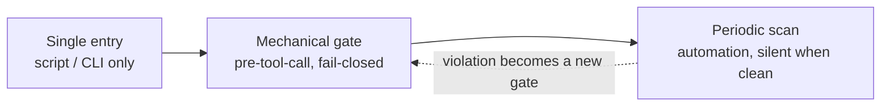

<p align="center">
  <b>Harness Governance</b><br>
  <i>Mechanical gates, ledgers and evaluations for long-lived coding agents.</i><br>
  <sub>Per-section English / 中文对照</sub>
</p>

<p align="center">
  
  
  
  
</p>

---

## What this is

A set of constraints for an agent that works unattended for months: it dispatches its own
sub-tasks, edits real repositories, and forgets everything between sessions.

这是一套约束，用来管住一个连续数月无人值守干活的 agent：它自己派发子任务、直接改真实仓库，而每次会话之间什么都不记得。

The core claim is simple: **an instruction the model can ignore is not a control.**
Every rule that matters has to be enforced by something that cannot be talked out of it —
a hook that blocks the tool call, a script that is the only way to perform the action, or a
scheduled scan that reports when nothing changed.

核心命题很简单：**模型可以无视的指令，不算控制。** 每一条真正要紧的规则，都必须由某种「说服不了」的东西来执行——拦住工具调用的 hook、作为该动作唯一路径的脚本，或者一个「什么都没变化也会报出来」的定时巡检。

This repository documents the three enforcement layers, the 23 rule packs behind them, the
ledger design that makes dispatch auditable, and the evaluation harness that keeps the gates
themselves honest. It is extracted from a personal agent that has been running daily for months,
with the machine-specific parts removed.

本仓记录三层执行机制、它们背后的 23 个规则包、让派发可审计的台账设计，以及让闸自身保持诚实的评估 harness。内容抽自一个已经每天运行数月、持续干活的个人 agent，机器相关的部分已全部剔除。

Companion repo: **[longmem](https://github.com/SquareXRay/longmem)** covers the memory side.

姊妹仓：**[longmem](https://github.com/SquareXRay/longmem)** 负责记忆那一侧。

---

## The problem it fixes

| Failure | What it looks like | Cost |
|---|---|---|
| **Rules decay into wishes** | "never commit without tests" lives in a prompt | model complies until it is busy |
| **Duplicate dispatch** | two sub-agents edit the same files | conflicting commits, wasted tokens |
| **Stale memory** | a rule contradicts today's code | acting on retired truth |
| **Gates that bite wrongly** | a safety gate blocks a legitimate task | you learn to bypass gates |
| **Gates that stop working** | a refactor silently disables a check | you believe you are protected |
| **Unaccountable decisions** | nobody remembers why a trade-off was chosen | the same argument, weekly |

| 故障 | 表现 | 代价 |
|---|---|---|
| **规则退化成愿望** | 「没有测试不许提交」只是 prompt 里的一句话 | 模型有空时遵守，忙起来就不守 |
| **重复派发** | 两个子 agent 改同一批文件 | 提交互相冲突、token 白烧 |
| **记忆过期** | 一条规则和今天的代码互相矛盾 | 按已经退休的「真相」行事 |
| **闸咬错人** | 一道安全闸拦住了一个正当任务 | 你学会绕闸走 |
| **闸静默失效** | 一次重构悄悄关掉了某项检查 | 你以为自己仍被保护着 |
| **决策无处追账** | 没人记得当初为什么这么取舍 | 同一场争论每周重来一次 |

---

## The core: independent agents, not independent opinions

A rule the model can ignore is not a control — and **a claim one agent makes about its own work is
not evidence.** Verification here is a second (and third) agent with no access to the first one's
reasoning: isolated context, read-only, forbidden to read each other, different model families where
possible, same brief and same raw material.

模型可以无视的规则，不算控制——而且**一个 agent 对自己工作的说辞，不是证据。** 这里的验证是第二个（以及第三个）agent，它拿不到第一个 agent 的推理过程：上下文隔离、只读、禁止互读、尽可能不同模型家族，同一份 brief、同一批原始材料。

下面这条流水线就是该原则的机械形态（代码块不翻译，中文说明在此）：每一腿只交「带 file:line 证据的主张」，合并不投票。

```
question → brief → legs 1..N (independent, read-only)
        → claims with file:line evidence
        → merge by evidence, never by vote (disagreement is kept)
        → only reproduced claims become tasks
```

The entry script **refuses a single leg** for judgement-type work; a dead leg fails the batch rather
than shrinking it; the panel proposes and a replay corpus decides. Full chapter:
[`docs/08-cross-validation.md`](docs/08-cross-validation.md).

入口脚本对判断题**直接拒绝单腿**；一条腿挂掉会把整批判为失败，而不是把批次缩小；评审团负责提议，回放语料负责判决。完整章节见 [`docs/08-cross-validation.md`](docs/08-cross-validation.md)。

## Three layers, one direction

三层机制及其回流关系（mermaid 代码块不翻译，中文说明在此）：下一层的违规要回流成上一层的闸。



| Layer | Mechanism | Property |
|---|---|---|
| **Single entry** | one script per action (dispatch, ask, memory write) | the path is the policy |
| **Mechanical gate** | hook before every tool call, default deny | cannot be argued with |
| **Periodic scan** | scheduled checks, zero output when healthy | catches drift, not intent |

| 层 | 机制 | 性质 |
|---|---|---|
| **单一入口** | 每个动作一个脚本（派发、提问、写记忆） | 路径本身就是策略 |
| **机械闸** | 每次工具调用前的 hook，默认拒绝 | 讲不通道理，只能遵守 |
| **周期巡检** | 定时检查，健康时零输出 | 抓得到漂移，抓不到意图 |

The dotted edge is the part most setups miss: **a violation must become a gate**, or the same
violation returns next month.

虚线那条边，是多数方案漏掉的部分：**一次违规必须变成一道闸**，否则同一种违规下个月还会回来。

---

## The second ledger: our own mistakes

Dispatch has a ledger; so does the harness's own failures. A tool-level error that costs a round trip
is written the same turn as one line — symptom, root cause, prevention — never a diary.

派发有台账，harness 自己的失败也有。一次让你返工的工具层错误，当回合就写成一行：现象、根因、预防——不是流水账。

| Stage | Mechanism |
|---|---|
| write | one entry per error, auto-numbered, same-type errors merged as `×N` |
| dedupe | an explicit merge flag (`--dup-of #N`) plus a structural emptiness check, not a byte-count heuristic |
| inject | at dispatch time, matching entries surface through entry-level retrieval; every hit is logged |
| graduate | three states (open / upgraded / expired); the **second** same-type error must become a rule, or the ledger is decorative |
| report | a recurrence report over the event stream, dry-run by default |

Two choices are worth copying: injection is **advisory** — it adds a line to the brief and never
rewrites the task — and the write path **never refuses** a new entry at the working-in-progress
ceiling, because a ledger that rejects writes during an incident is useless exactly when you need it.

两个值得照抄的选择：注入是**顾问性**的——只往任务书里加一行，绝不改写任务；写入路径在工作量上限处**永不拒写**——事故正发生时还拒收的错题本，等于没有。

## What ships in the rule layer

| Group | Rule packs | Purpose |
|---|---|---|
| Dispatch | flow, duplicate, route, concurrency, collector-wake | no unregistered spawn, no two writers on one file set |
| Accounting | ledger, ask, commit discipline, one-shot automation | every "I will do X later" has a row |
| Safety | dangerous commands, protected paths, inline payload, upstream sync | destructive work needs an explicit exception |
| Budget and context | token budget, M31 gate, spawn concurrency | cost is bounded before the call, not after |
| Observation | probe expectations, registration observe, startup verify | the gate system reports on itself |
| Multi-agent / multi-provider | routing table, leg tokens, concurrency caps | panels only where judgement is needed; single legs refused for audits |

| 组 | 规则包 | 用途 |
|---|---|---|
| 派发 | flow、duplicate、route、concurrency、collector-wake | 不许未登记的 spawn，不许两个写者碰同一批文件 |
| 记账 | ledger、ask、提交纪律、一次性自动化 | 每一句「我稍后做 X」都有一行 |
| 安全 | 破坏性命令、受保护路径、内联载荷、上游同步 | 破坏性工作必须显式例外 |
| 预算与上下文 | token 预算、M31 闸、spawn 并发 | 成本在调用之前就被限住，不是事后 |
| 观测 | 探针期望、注册观测、启动自检 | 闸系统自己也出报告 |
| 多 agent / 多 provider | 路由表、leg 令牌、并发上限 | 只在需要判断的地方开评审团；审计单腿直接拒 |

Details and the block/allow contract: [`docs/03-gates.md`](docs/03-gates.md).

细节与「拦/放」契约见 [`docs/03-gates.md`](docs/03-gates.md)。

---

## Why panels, and not just parallel workers

Parallelism gives you throughput. Independent agents checking each other give you **epistemic
value** — a way to notice when the whole system, including its gates, is confidently wrong.
Providers are plumbing for that independence: a routing table by role, heterogeneous families where
judgement is required, and a hard refusal of single-leg audits. See chapter 8.

并行给你吞吐量；互相独立检查的 agent 给你**认识论上的价值**——一种发现「整个系统连同它的闸都自信地错了」的办法。provider 只是这套独立性的管道：按角色排的路由表、需要判断的地方用异构家族、审计单腿硬拒。见第 8 章。

## Numbers from the deployment it came from

These are scale indicators, not targets:

以下是规模指标，不是目标：

- 23 rule packs, ~4.2k lines of gate logic, 65 test files for the gates alone
- 274 probe assertions in 92 paired cases (each gate has a must-block and a must-allow case)
- ~34k telemetry events accumulated; every block carries a machine-readable reason
- 78 operational scripts; dispatch, queue and memory flows are script-only
- memory: 23 files / ~480 KB total, index file under 20 KB, topic files capped at 40 KB

- 23 个规则包、约 4.2k 行闸逻辑、仅闸本身就有 65 个测试文件
- 92 组成对用例里的 274 条探针断言（每道闸都有一个必须拦的用例和一个必须放的用例）
- 累积约 3.4 万条遥测事件；每一次拦截都带一个机器可读的原因
- 78 个运维脚本；派发、队列与记忆流转只走脚本
- 记忆：23 个文件 / 共约 480 KB，索引文件小于 20 KB，主题文件上限 40 KB

---

## Read order

1. [`docs/01-principles.md`](docs/01-principles.md) — why "narrow, never widen" and "fail closed"
2. [`docs/02-architecture.md`](docs/02-architecture.md) — the five layers end to end
3. [`docs/03-gates.md`](docs/03-gates.md) — how to write a gate that survives refactoring
4. [`docs/04-orchestration.md`](docs/04-orchestration.md) — dispatch ledger, single-use tokens, serial queue
5. [`docs/05-evaluation.md`](docs/05-evaluation.md) — double probes, deterministic checks, telemetry
6. [`docs/06-incidents.md`](docs/06-incidents.md) — five failures that shaped the design
7. [`docs/07-adoption.md`](docs/07-adoption.md) — a minimum viable harness in five steps
8. [`docs/08-cross-validation.md`](docs/08-cross-validation.md) — **the centre**: independent agents checking each other, evidence over votes, fail-closed panels

1. [`docs/01-principles.md`](docs/01-principles.md) —— 为什么是「只许收窄、不许放宽」和「失败朝严」
2. [`docs/02-architecture.md`](docs/02-architecture.md) —— 五层结构端到端
3. [`docs/03-gates.md`](docs/03-gates.md) —— 怎么写一道经得起重构的闸
4. [`docs/04-orchestration.md`](docs/04-orchestration.md) —— 派单台账、一次性令牌、串行队列
5. [`docs/05-evaluation.md`](docs/05-evaluation.md) —— 双探针、确定性检查、遥测
6. [`docs/06-incidents.md`](docs/06-incidents.md) —— 五次塑造了设计的事故
7. [`docs/07-adoption.md`](docs/07-adoption.md) —— 五步搭出最小可用 harness
8. [`docs/08-cross-validation.md`](docs/08-cross-validation.md) —— **中心**：独立 agent 互检、证据优先于票数、评审团失败朝严

