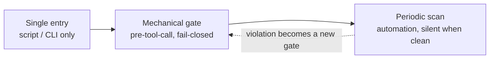

  <b>Harness Governance</b> 
  <i>Mechanical gates, ledgers and evaluations for long-lived coding agents.</i> 
  English first · 中文摘要附后

  
  
  
  

---

## What this is

A set of constraints for an agent that works unattended for months: it dispatches its own
sub-tasks, edits real repositories, and forgets everything between sessions.

The core claim is simple: **an instruction the model can ignore is not a control.**
Every rule that matters has to be enforced by something that cannot be talked out of it —
a hook that blocks the tool call, a script that is the only way to perform the action, or a
scheduled scan that reports when nothing changed.

This repository documents the three enforcement layers, the 21 rule packs behind them, the
ledger design that makes dispatch auditable, and the evaluation harness that keeps the gates
themselves honest. It is extracted from a personal agent that has been running daily for months,
with the machine-specific parts removed.

Companion repo: **[longmem](https://github.com/SquareXRay/longmem)** covers the memory side.

---

## The problem it fixes

| Failure | What it looks like | Cost |
|---|---|---|
| **Rules decay into wishes** | "never commit without tests" lives in a prompt | model complies until it is busy |
| **Duplicate dispatch** | two sub-agents edit the same files | conflicting commits, wasted tokens |
| **Stale memory** | a rule contradicts today's code | acting on retired truth |
| **Gates that bite wrongly** | a safety gate blocks a legitimate task | you learn to bypass gates |
| **Gates that stop working** | a refactor silently disables a check | you believe you are protected |
| **Unaccountable decisions** | nobody remembers why a trade-off was chosen | the same argument, weekly |

---

## Three layers, one direction

| Layer | Mechanism | Property |
|---|---|---|
| **Single entry** | one script per action (dispatch, ask, memory write) | the path is the policy |
| **Mechanical gate** | hook before every tool call, default deny | cannot be argued with |
| **Periodic scan** | scheduled checks, zero output when healthy | catches drift, not intent |

The dotted edge is the part most setups miss: **a violation must become a gate**, or the same
violation returns next month.

---

## What ships in the rule layer

| Group | Rule packs | Purpose |
|---|---|---|
| Dispatch | flow, duplicate, route, concurrency, collector-wake | no unregistered spawn, no two writers on one file set |
| Accounting | ledger, ask, commit discipline, one-shot automation | every "I will do X later" has a row |
| Safety | dangerous commands, protected paths, inline payload, upstream sync | destructive work needs an explicit exception |
| Budget and context | token budget, M31 gate, spawn concurrency | cost is bounded before the call, not after |
| Observation | probe expectations, registration observe, startup verify | the gate system reports on itself |
| Multi-agent / multi-provider | routing table, leg tokens, concurrency caps | panels only where judgement is needed; single legs refused for audits |

Details and the block/allow contract: [`docs/03-gates.md`](docs/03-gates.md).

---

## Two axes that scale it

Most harnesses stop at "one agent, one model". The two axes that turn it into an operator are
covered in [`docs/08-multi-agent-and-providers.md`](docs/08-multi-agent-and-providers.md):

- **several agents, one ledger** — isolated contexts, disjoint file claims, evidence-based closes,
  concurrency caps by kind, fallback wakes when completion events are dropped;
- **several providers, one routing table** — roles instead of brands, single legs refused for
  audit work, disagreement preserved rather than averaged, budgets checked before dispatch.

They are not independent: parallel workers only pay off when they are isolated, and isolation is
only trustworthy when the panel is heterogeneous.

## Numbers from the deployment it came from

These are scale indicators, not targets:

- 21 rule packs, ~4.2k lines of gate logic, 65 test files for the gates alone
- 274 probe assertions in 92 paired cases (each gate has a must-block and a must-allow case)
- ~34k telemetry events accumulated; every block carries a machine-readable reason
- 78 operational scripts; dispatch, queue and memory flows are script-only
- memory: 23 files / ~480 KB total, index file under 20 KB, topic files capped at 40 KB

---

## Read order

1. [`docs/01-principles.md`](docs/01-principles.md) — why "narrow, never widen" and "fail closed"
2. [`docs/02-architecture.md`](docs/02-architecture.md) — the five layers end to end
3. [`docs/03-gates.md`](docs/03-gates.md) — how to write a gate that survives refactoring
4. [`docs/04-orchestration.md`](docs/04-orchestration.md) — dispatch ledger, single-use tokens, serial queue
5. [`docs/05-evaluation.md`](docs/05-evaluation.md) — double probes, deterministic checks, telemetry
6. [`docs/06-incidents.md`](docs/06-incidents.md) — four failures that shaped the design
7. [`docs/07-adoption.md`](docs/07-adoption.md) — a minimum viable harness in five steps
8. [`docs/08-multi-agent-and-providers.md`](docs/08-multi-agent-and-providers.md) — several agents, one ledger; several providers, one routing table

---

## 中文摘要（为辅）

这套东西的命题只有一句：**模型可以无视的规则，不算控制。** 真正要守住的纪律必须落在三种东西上——
拦得住工具调用的 hook、唯一入口的脚本、以及零输出即健康的周期巡检。

本仓记录三层机制、21 个规则包、派单台账与一次性令牌的设计，以及「闸自身也要被测试」的双探针体系。
它抽自一个持续跑了数月、每天派活改真实仓库的个人 agent，机器相关信息已全部剔除。

与 **[longmem](https://github.com/SquareXRay/longmem)** 互补：那边是记忆，这边是执行与治理。

关键数字（规模参考，不是指标）：21 个规则包、约 4.2k 行闸逻辑、闸自身的 65 个测试文件、
274 条双探针断言（每组都要求「该拦的拦、该放的放」）、约 3.4 万条遥测事件、78 个运维脚本。

两个扩展轴（精髓所在）：**多 agent 一本台账**（隔离上下文 / 文件集互斥 / 带证据收口 / 兜底唤醒）与
**多 provider 一张路由表**（按角色不按牌子 / 审计单腿直接拒 / 分歧保留不取平均 / 预算先判）。
详见 `docs/08-multi-agent-and-providers.md`。

阅读顺序同上；若只读一篇，读 `docs/03-gates.md`。
