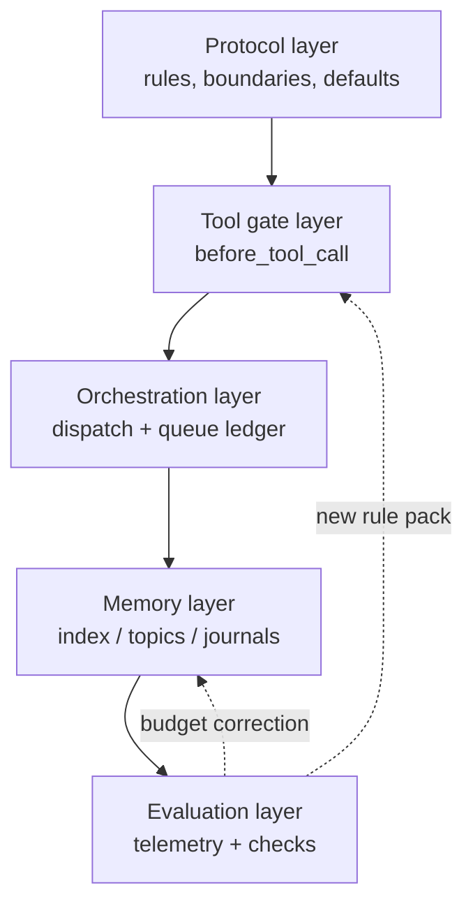

# 02 · Architecture

The system is five layers, and each layer exists because the layer above it was insufficient.

这套系统是五层，每一层之所以存在，都是因为上面那一层不够用。

| Layer | What it holds | Read when | Enforced by |
|---|---|---|---|
| **Protocol** | identity, boundaries, routing, the decision-default table | every turn (injected) | injected size budget |
| **Tool gates** | 21 rule packs on `before_tool_call` | every tool call | hook (block / allow) |
| **Orchestration** | dispatch ledger, tokens, queue states, sub-agent runs | every delegation | entry scripts |
| **Memory** | index, topics, journals, incident ledger, cold volumes | trigger-word or search | budget + structure gates |
| **Evaluation** | telemetry, deterministic checks, e2e tasks, periodic scans | scheduled | reports + silent scans |

| 层 | 承载什么 | 何时读 | 由什么执行 |
|---|---|---|---|
| **协议** | 身份、边界、路由、决策默认值表 | 每一轮（注入） | 注入体积预算 |
| **工具闸** | `before_tool_call` 上的 21 个规则包 | 每次工具调用 | hook（拦 / 放） |
| **编排** | 派单台账、令牌、队列状态、子会话运行 | 每次委派 | 入口脚本 |
| **记忆** | 索引、主题、日志、事故台账、冷卷 | 触发词或检索 | 预算 + 结构闸 |
| **评估** | 遥测、确定性检查、e2e 任务、周期巡检 | 定时 | 报告 + 静默巡检 |

下面这张图把五层与两条回流边画在一起（mermaid 代码块不翻译，中文说明在此）：评估层回流新的规则包给闸层，并回流预算修正给记忆层。



## Why this order

**Protocol first**, because everything downstream inherits its vocabulary. If the protocol file
contains facts that change weekly, the injection budget is consumed by history instead of rules.

**协议在前**，因为下游一切都继承它的词汇。如果协议文件里塞的是每周都变的事实，注入预算就被历史吃掉了，而不是被规则用掉。

**Gates second**, because the protocol cannot stop anything. The gate layer is where a rule
becomes a refusal with a reason string attached.

**闸在第二**，因为协议什么都拦不住。闸这一层，才是规则变成「带理由串的拒绝」的地方。

**Orchestration third**, because delegation is where unattended agents do the most damage: two
sub-agents on one file set, a spawn that bypasses the ledger, a task that dies because nobody
collected it.

**编排第三**，因为委派正是无人值守 agent 造成最大破坏的地方：两个子 agent 盯同一批文件、一次绕过台账的 spawn、一个因为没人收而烂在那里的任务。

**Memory fourth**, because it is the layer that silently rots. It needs budgets (so it cannot
crowd out the task) and structure checks (so the index cannot drift from the files).

**记忆第四**，因为它是那层会悄悄腐烂的东西。它需要预算（以免挤掉任务本身），也需要结构检查（以免索引与磁盘上的文件漂移）。

**Evaluation last but not least**, because every layer above can regress without failing loudly.

**评估放在最后，但同样重要**，因为上面任何一层都可能在不出声的情况下退化。

## Data flow of one action

下面是一次派活的数据流（代码块不翻译，中文说明在此）：模型想派子 agent → hook 看见 `sessions_spawn` → 按规则包查该任务 id 有没有一次性令牌 → 没有就拦，并给出能创建令牌的那条命令 → 有就核销令牌、登记运行、放行。

```
model wants to spawn a sub-agent
  → hook sees sessions_spawn
  → rule pack: is there a single-use token for this task id?
      no  → block, with the exact command that would create one
      yes → consume token, register the run, allow
  → sub-agent starts, ledger row goes ready → running
  → sub-agent writes a file that another running task also declares
      → duplicate gate blocks the second write path
  → sub-agent closes with evidence (commit sha)
  → ledger row done; dependent rows promoted by the queue
```

Every arrow in that chain is observable: the block reason names the missing token, the ledger row
names the session, the close names the commit.

这条链上的每一个箭头都是可观测的：拦截理由点名缺失的令牌，台账行点名会话，收口点名 commit。

