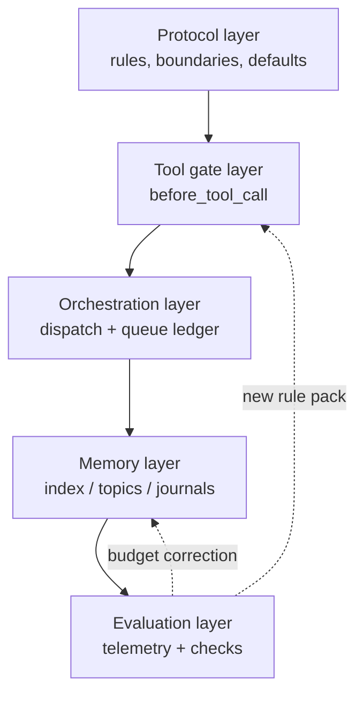

# 02 · Architecture

The system is five layers, and each layer exists because the layer above it was insufficient.

| Layer | What it holds | Read when | Enforced by |
|---|---|---|---|
| **Protocol** | identity, boundaries, routing, the decision-default table | every turn (injected) | injected size budget |
| **Tool gates** | 21 rule packs on `before_tool_call` | every tool call | hook (block / allow) |
| **Orchestration** | dispatch ledger, tokens, queue states, sub-agent runs | every delegation | entry scripts |
| **Memory** | index, topics, journals, incident ledger, cold volumes | trigger-word or search | budget + structure gates |
| **Evaluation** | telemetry, deterministic checks, e2e tasks, periodic scans | scheduled | reports + silent scans |



## Why this order

**Protocol first**, because everything downstream inherits its vocabulary. If the protocol file
contains facts that change weekly, the injection budget is consumed by history instead of rules.

**Gates second**, because the protocol cannot stop anything. The gate layer is where a rule
becomes a refusal with a reason string attached.

**Orchestration third**, because delegation is where unattended agents do the most damage: two
sub-agents on one file set, a spawn that bypasses the ledger, a task that dies because nobody
collected it.

**Memory fourth**, because it is the layer that silently rots. It needs budgets (so it cannot
crowd out the task) and structure checks (so the index cannot drift from the files).

**Evaluation last but not least**, because every layer above can regress without failing loudly.

## Data flow of one action

```
model wants to spawn a sub-agent
  → hook sees sessions_spawn
  → rule pack: is there a single-use token for this task id?
      no  → block, with the exact command that would create one
      yes → consume token, register the run, allow
  → sub-agent starts, ledger row goes queued → inflight
  → sub-agent writes a file that another inflight task also declares
      → duplicate gate blocks the second write path
  → sub-agent closes with evidence (commit sha)
  → ledger row done; dependent rows promoted by the queue
```

Every arrow in that chain is observable: the block reason names the missing token, the ledger row
names the session, the close names the commit.

---

## 中文摘要

五层：协议（每轮注入）→ 工具闸（每次调用）→ 编排（每次派活）→ 记忆（触发词或检索）→ 评估（定时）。
顺序不是美学：协议提供词汇，闸把词汇变成拒绝，编排决定无人值守时最危险的动作，记忆最会悄悄腐烂，
评估用来发现上面任何一层退化。

一次派活的完整链路：hook 看 `sessions_spawn` → 查一次性令牌 → 无则拦并给出该敲的命令 → 有则核销并登记 →
台账 queued→inflight → 若与在途任务文件集相交则拦第二条写路径 → 子会话带 commit 收口 → 台账 done → 依赖行自动放行。
每一环都有可观测的名字：拦的理由、台账的会话、收口的 commit。
